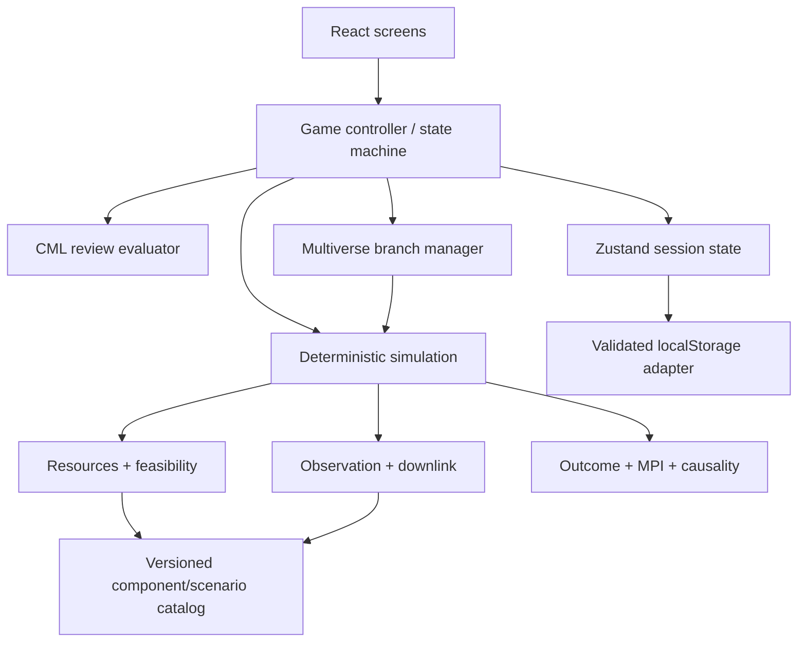
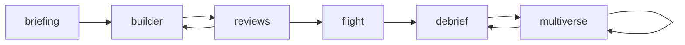

# LUNA-01 — ARCHITECTURE.md

> **Status:** Proposed implementation baseline, not yet approved. Companion to [GAME_RULES.md](GAME_RULES.md). All mission numbers are illustrative educational parameters, not NASA/GMAT-validated data.

## Architecture decision record
**Decision:** Static client-side React + Vite + TypeScript modular monolith. No backend, auth, API keys, live GMAT, database or external simulation dependency. Domain rules are pure TypeScript. UI consumes typed results only.

**Dependencies:** `UI -> app controller/store -> domain -> versioned data`. Domain never imports UI, storage or network modules.

## Logical topology

## Module boundaries
| Module | Owns | Must not own |
|---|---|---|
| `domain/engineering` | Component totals, feasibility blockers/warnings | UI state |
| `domain/reviews` | CML gate evidence and invalidation | Simulation physics |
| `domain/simulation` | Event resolution, science return, outcome | Animation timing |
| `domain/scoring` | MPI and efficiency | Mission outcome decisions |
| `domain/causality` | Traceable findings | Free-form LLM explanations |
| `domain/multiverse` | Immutable branching, validation, comparison | React components |
| `app` | Phase transitions, orchestration, save/load | Duplicated domain formulas |
| `features/*` | User interaction and rendering | Reimplementing engine rules |

## Game state machine

State invariants:
- `flight` is reachable only after reviews authorized against the current config hash.
- Editing configuration after authorization returns to reviews and invalidates relevant evidence.
- Observation choice must precede downlink choice; UI must not skip unresolved decisions.
- Debrief requires a completed `SimulationAttempt`.
- Multiverse unlocks only after root universe is completed.
- Counterfactual branches do not receive a false CML approval; UI labels their status accurately.

## Simulation vs playback
**Single source of truth:** `simulateMission(input)` computes the entire deterministic result. During first playthrough, UI collects observation and downlink choices sequentially; preview helpers may display known consequences, but no second gameplay-specific engine exists. Once both decisions exist, compute final result, then play back ordered `ResolvedEvent[]` with optional CSS/SVG animation. UI timing cannot change outcomes.

## Persistence
- Store only validated `GameSave` with `schemaVersion: 1`, `modelVersion`, `phase`, current draft config, review evidence, root/universe collection, and optional UI preferences.
- Persist under a versioned key, e.g. `luna01:save:v1`; cap at 8 universes.
- Validate with Zod on load; on corruption show reset/recover UI, never silently rewrite outcomes.
- Old model versions should be read-only or explicitly reset/migrated; never recompute old snapshots under new rules without consent.
- Save after completed transitions, not on every animation frame.
- No personal data required. Clear-all/reset is explicit.

## UI screens and ownership
1. `BriefingScreen`: mission premise, disclaimers, start.
2. `BuilderScreen`: five selections, metrics, blockers/warnings, alternative configuration save.
3. `ReviewScreen`: CML 1–4 evidence; trade study compares two distinct configs, rationale selection, warning acknowledgments.
4. `FlightScreen`: scripted arrival, E1/E2 prompts, event trace.
5. `DebriefScreen`: outcome, MPI breakdown, science returned, resource productivity, causal chain.
6. `MultiverseScreen`: parent selection, one-field edit, rejection explanations, branch tree, side-by-side comparison.

## Data provenance
- Component catalog and trajectory numbers: `modelSource='illustrative'`.
- UI displays a persistent 'Educational model / illustrative values' note on metrics and debrief.
- GMAT-derived values are not present in MVP. Future inclusion requires verified dataset, GMAT version, script name, assumptions and source artifact.
- Do not use generic NASA branding to imply NASA endorsement.

## Security and performance
- No secret keys, third-party API calls or remote user data.
- Validate imported saves and catalog lookups; escape displayed strings through React rendering.
- Simulations are cheap (32 configs × 4 decision pairs = 128 combinations); run synchronously, no worker needed.
- All engine tests run without DOM. Prefer deterministic SVG over 3D dependencies.
- Accessibility: keyboard navigable controls, readable contrast, reduced-motion support, descriptive result text independent of animation.

## Integration rules
- Shared types defined before parallel UI/domain work.
- UI may use typed fixture results, but must replace fixtures with real engine integration before release.
- No agent changes `GAME_RULES.md` constants without documenting impact and updating acceptance tests.
- Require `npm run typecheck`, `npm test`, and `npm run build` before merging a milestone.

## Risks and mitigations
| Risk | Mitigation |
|---|---|
| Review gate complexity delays playable loop | Minimal CML interactions; keep trade study meaningful |
| Multiverse duplicates simulation logic | One `simulateMission` function for all timelines |
| Score seems arbitrary | Show breakdown, assumptions and raw efficiency ratio |
| All missions too similar | Expose power/downlink/trajectory trade-offs and compare causal events |
| Agent merge conflicts | File ownership, typed contracts, integration checkpoints |
| Deployment failure | Static build and local `npm run preview` fallback |

## Definition of architecture complete
Type contracts compile; state transitions documented; no duplicate mission logic; all six screens have explicit input/output contracts; storage schema and version policy specified; branch rejection and review semantics unambiguous.
